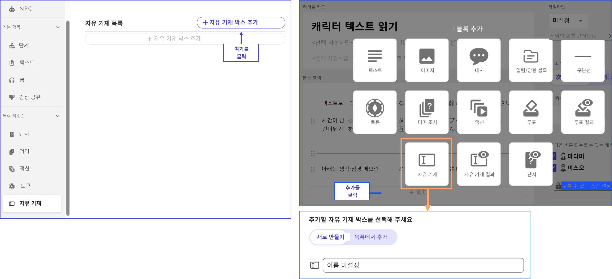

# 자유 기재

플레이어가 임의의 문자열을 입력할 수 있는 박스입니다. 다음과 같이 사용할 수 있습니다.

<table><thead><tr><th width="197.99993896484375">사용 예</th><th>설명</th></tr></thead><tbody><tr><td>메모란</td><td>추리나 감정을 메모하는 칸으로 설치하는 사용법입니다. 머더 미스터리·TRPG 커뮤니티에서는 「혼잣말」라고도 부릅니다.</td></tr><tr><td>서술형 답변란</td><td>동기나 트릭 등을 서술형으로 답하게 할 때의 사용법입니다.</td></tr><tr><td>메시지 전송</td><td>A 씨가 입력한 내용을 B 씨가 볼 수 있게 하는 사용법입니다.</td></tr></tbody></table>

## 기본 

### 신규 작성 

자유 기재 박스는 「자유 기재 편집 화면」 또는 「단계 편집 화면」에서 새로 만들 수 있습니다.

<figure><figcaption></figcaption></figure>

### 입력 박스와 결과 표시 박스 

자유 기재에는 글자를 입력하거나 지울 수 있는 「입력 박스」와, 입력된 결과를 보기만 하는 「결과 표시 박스」가 있습니다.

<figure><figcaption></figcaption></figure>

| 입력 박스                                                                               | 결과 표시 박스                                                                                  |
| ----------------------------------------------------------------------------------- | ----------------------------------------------------------------------------------------- |
| 
글자를 입력하거나 지울 수 있습니다. 같은 박스를 여러 단계에 설치한 경우, 앞 단계에서 입력한 내용이 이어집니다.
          | 글자를 입력하거나 지울 수 없고, 입력 결과를 보기만 하는 박스입니다. 입력 박스에서 편집한 내용이 실시간으로 반영됩니다.                      |
| 
기본 단계*에만 설치할 수 있습니다. 

*함께 읽기·게임의 흐름·탐색 단계를 제외한 일반적인 단계를 말합니다.
   | 
・기본 단계／탐색 단계 ・텍스트 ・단서 ・감상 공유 화면 에 설치할 수 있습니다.
                          |
| 
각 플레이어에게는 자신이 입력한 내용만 보입니다. A 씨용·B 씨용으로 나눌 필요가 없으며, 기본적으로 표시 조건도 필요 없습니다.
 | 
【어떤 자유 기재】에서 【누구】의 답변을 표시할지 지정해야 합니다. 다른 캐릭터에게 보이면 안 되는 서술 결과라면 표시 조건을 걸어야 합니다.
 |

<figure><figcaption></figcaption></figure>

## 실제 사용 예 

### 메모란&#xD; 

메모란용 자유 기재 박스를 하나 새로 만들고, 텍스트 읽기 단계나 토론 단계에 같은 입력 박스를 설치합니다.

<figure><figcaption></figcaption></figure>

입력 박스를 설치하지 않은 단계나 함께 읽기 단계에서는 메모를 다시 볼 수 없으므로, 따로 텍스트에 결과 표시 박스를 설치하는 것을 추천합니다.

<figure><figcaption></figcaption></figure>

### 서술형 답변란 

동기나 트릭 등을 선택지에서 고르는 방식이 아니라 서술형으로 답하게 할 때의 사용법입니다.\
예를 들어 「캐릭터 1: 마다미」가 동기를 서술형으로 답하고, 그 정답 여부를 「캐릭터 2: 미스오」가 판정하는 경우의 설정 예는 다음과 같습니다.

<figure><figcaption></figcaption></figure>

### 메시지 전송 

채팅이나 텔레파시를 연출하는 사용법입니다. 메시지를 보내는 쪽에는 입력 박스를, 받는 쪽에는 결과 표시 박스를 설치합니다.\
입력 내용이 바뀌어도 알림은 자동으로 가지 않으므로, [심플 액션](action.md#shinpuruakushonno)을 이용해 알림을 보낼 수 있게 설정하는 것을 추천합니다. 아래 예에서는 메시지가 단서로 전달되는 형태이지만, 단계에 결과를 바로 표시해도 좋습니다.

<figure><figcaption></figcaption></figure>
