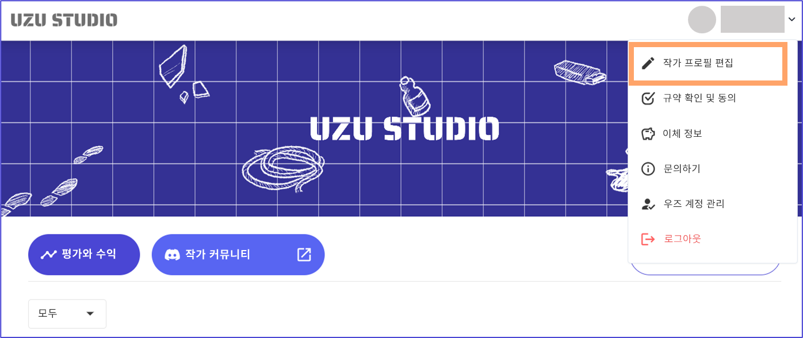

# 작가 프로필 변경

우즈 스튜디오의 메인 화면인 제작 시나리오 목록 화면에서 작가 프로필을 변경할 수 있습니다.

## 변경 절차

**① 오른쪽 위의 아이콘을 클릭**

**② 작가 프로필 편집을 선택**

<figure><figcaption></figcaption></figure>

**③ 작가 프로필을 수정하여 저장**

설정 항목

* 작가명: 우즈 플레이어 닉네임과는 별도로 설정할 수 있습니다
* 커버 이미지: 사이즈는 [여기](../others/image-px.md)를 참고하세요.
* 아이콘 이미지: 우즈 플레이어 아이콘과는 별도로 설정할 수 있습니다
* 소개문
* 링크

<figure><figcaption></figcaption></figure>

## 작가 페이지 버튼 

작가 프로필을 편집하면, 우즈 스튜디오와 연동된 앱 우즈의 계정에 「작가 페이지」 버튼이 나타납니다.

작가 페이지에서는 릴리스한 시나리오의 목록과 좋아요 수의 합계를 확인할 수 있습니다.

<figure><figcaption></figcaption></figure>

## **플레이용 계정을 알리고 싶지 않은 경우**

위 절차대로 변경하면, 작가 페이지에는 플레이어로서의 '아이콘'이나 '닉네임'과는 완전히 다른 것을 표시할 수 있습니다. 작가 페이지에는 '사용자 ID'가 표시되지 않으므로 **플레이용 계정이 드러날 일은 없습니다.**

따라서 플레이용 계정과 별도로 ID를 만들어 **작가용 더미 계정을 둘 필요는 없습니다.**

<figure><figcaption></figcaption></figure>
