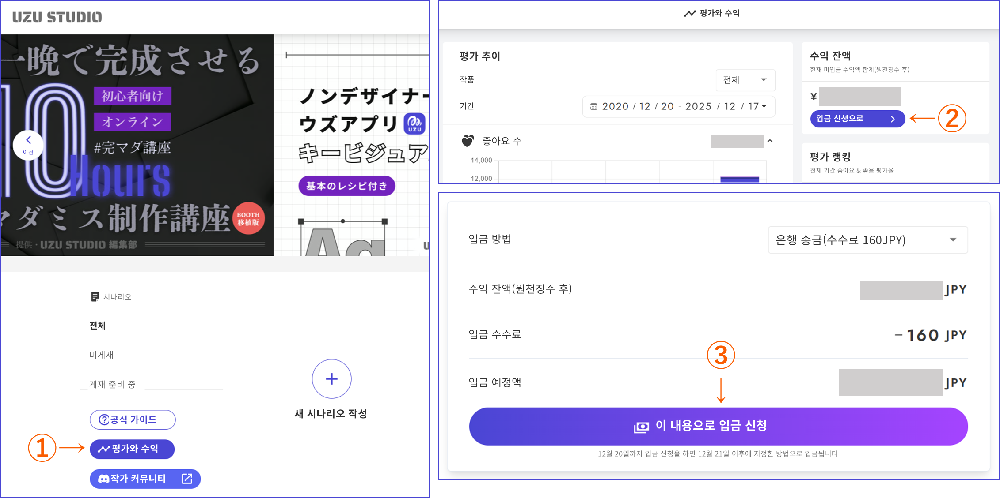

# 매출 정산 받기

매출을 수령하려면 「입금처 정보」설정과 「입금 신청」이 필요합니다.

## 입금처 정보 설정

입금처 정보의 설정은 우즈 스튜디오의 제작 시나리오 목록 화면 오른쪽 위에 있는 아이콘에서 진행합니다.

<figure><figcaption></figcaption></figure>

본인 확인을 위해 성명·이메일 주소·생년월일·계좌 정보가 필요합니다. 이체는 은행 이체로 진행됩니다.

## 입금 신청

매출은 월말에 집계되며, 익월부터 입금 신청을 할 수 있게 됩니다. 입금 신청은 「평가와 수익」 화면에서 진행합니다.

(스마트폰의 경우 가로로 들면 「평가와 수익」버튼이 표시됩니다)

<figure><figcaption></figcaption></figure>

「평가와 수익」 화면의 「입금 신청」에 매출 합계가 표시됩니다.

「이 내용으로 입금 신청」을 누르면 신청이 완료됩니다. 입금은 버튼을 누른 달의 21일 이후부터 다음 달 사이에 이루어집니다.

매월 21일부터 말일까지는 처리 중이므로 입금 신청 버튼을 누를 수 없습니다.

## **인세율**

우즈 스튜디오 유료 공개 규약 안의 「요금표」에서 확인하실 수 있습니다. 규약 확인 방법은 <a href="https://docs.studio.uzu-app.com/ko/top/term-agreement" target="_blank">여기</a>를 참고해 주세요.
